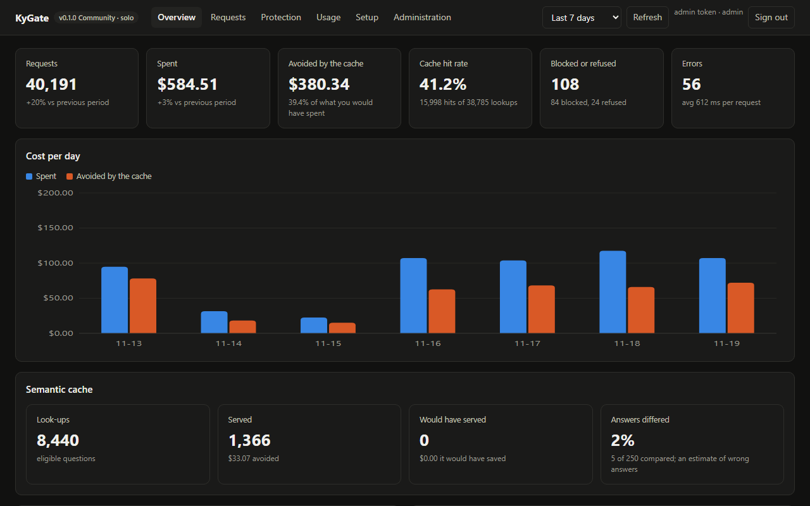
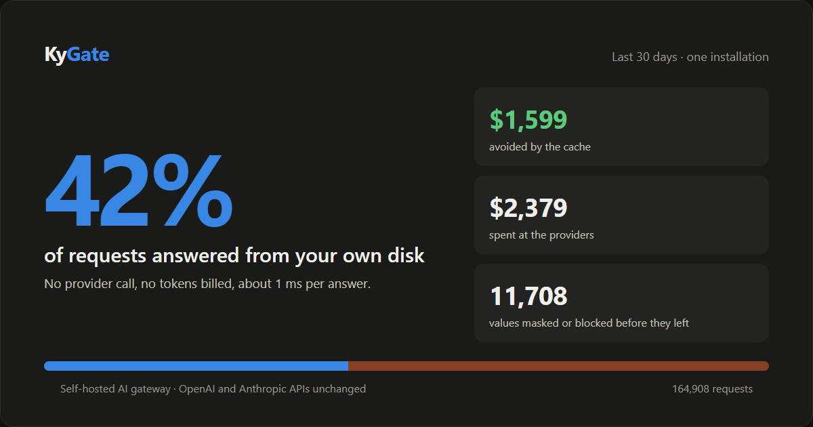

# KyGate

**A self-hosted AI gateway that keeps your sensitive data in and your AI bill down.**



<sub>The built-in console, shown with demo data.</sub>

KyGate sits between your applications and the AI models they call, whether paid APIs (OpenAI, Anthropic) or models you run yourself (Ollama, vLLM, llama.cpp). Applications keep their existing OpenAI or Anthropic client code; they change only the **base URL** and the **API key**.

It is one binary. The first start needs nothing else: no Python, no database server, no container. Every other capability is an option you turn on when you need it.

> **Version 0.1.2**: every text field a model reads is now inspected, tool definitions included; a data type the Guard cannot find follows `on_guard_unavailable` instead of passing unmasked; callers that share one model call can leave at any time; headers that change an answer are part of the cache key. This repository is **KyGate Community**: free and open source under Apache 2.0. Single sign-on, SCIM, a KMS-held master key, and a tamper-evident audit ledger with SIEM export are in **KyGate Enterprise**: see [For companies](#for-companies-kygate-enterprise).
>
> Figures marked *target* or *estimate* in the docs are design assumptions; measured figures say so.

## Why KyGate

| | What you get |
|---|---|
| 💰 **Pay once for the same answer** | Repeated requests are answered from a cache **on your own disk**, encrypted, kept 30 days and across restarts. A cache hit costs **$0** and comes back in about **1 ms**. |
| 🔒 **Secrets and personal data stay home** | API keys in a prompt are blocked; card numbers and IBANs are replaced with placeholders such as `[CREDIT_CARD_1]` before the request leaves, and put back in the answer. The provider never sees the real value. |
| 🧩 **No code change** | Unmodified OpenAI and Anthropic SDKs, streaming and tool calls included. Change two lines. |
| 🪶 **Start light, add what you need** | One Go binary with SQLite inside. The Guard (ML detection), PostgreSQL, Valkey, and Kubernetes are all optional add-ons. |
| 📊 **See what you spent and saved** | A built-in console: cost per day, model, and key; money avoided by the caches; what was found and blocked. |
| 🛡️ **Safe by default** | If KyGate cannot inspect a request, it does not send it. Real values never reach a log, a cache, or a database. Provider keys are never shown. |
| 🏠 **Self-hosted, open source** | Your prompts, your keys, your machines. Apache 2.0, and no telemetry sent anywhere. |

## Your disk is your cheapest model

Most AI traffic repeats itself: the same questions, the same system prompts, the same test suites, the same agent steps. Every repeat sent to a provider is paid again. KyGate keeps the answers **locally** and pays only for what is new.

<p align="center"></p>
<p align="center"><sub>An example of what the console reports, with demo data. Your share depends on how often your traffic repeats.</sub></p>

| Saving | How it works | Where it lives | On by default |
|---|---|---|---|
| **Exact cache** | The same request (same model, messages, tools, settings, API version and beta flags) is answered from the cache | Memory, then `cache.db` in your data directory: compressed and encrypted, 1 GB by default, least recently used entries go first | ✅ Yes, 30 days |
| **Semantic cache** | A look-alike question ("whats the capital of france" after "What is the capital of France?") reuses the stored answer, after strict checks on numbers, names, negations, and language | `cache.db`, next to the exact cache | Off. Starts in shadow mode: it shows what it *would* have served before it serves anything |
| **Coalescing** | Identical requests that arrive at the same moment share one provider call | Memory | ✅ Yes |
| **Provider prompt-cache markers** | Long Anthropic prompts get `cache_control` markers, so the next turn is billed at about a tenth of the price | Your provider | ✅ Yes |
| **Router (shadow)** | Records which cheaper model could have answered, and what it would have saved. Changes nothing | Reports | ✅ Shadow only |
| **Budgets** | Monthly and daily limits per organization, team, project, key, or person. Past a soft limit, a cheaper tier; past a hard one, a refusal | Policy file | Off |

Because sensitive values are masked **before** the cache, a cached answer holds placeholders, never real data. One user's answer can be reused for another, and each gets their own values put back.

See it work: send the same request twice and read the headers.

```sh
curl -si http://127.0.0.1:4000/v1/chat/completions \
  -H "Authorization: Bearer kg-..." -H "Content-Type: application/json" \
  -d '{"model":"gpt-4o-mini","messages":[{"role":"user","content":"What is the capital of France?"}]}' \
  | grep -i '^x-kygate-cache'
# first time:  X-KyGate-Cache: miss
# second time: X-KyGate-Cache: hit
#              X-KyGate-Cache-Kind: exact
```

The console's Overview shows the money the cache avoided. Measured on a laptop: an exact-cache hit returns its first byte in 1.2 ms at p95, and KyGate adds about 1.5 ms to a model call ([eval/load](eval/load/README.md)).

## Quick start

Get it. You need Go 1.26.11 or later, and no C compiler, Node, or Python.

```sh
go install github.com/Kytherion/KyGate/cmd/kygate@latest   # puts kygate in your Go bin folder

# or build it from a clone:
git clone https://github.com/Kytherion/KyGate.git && cd KyGate
go build -o kygate ./cmd/kygate          # on Windows: go build -o kygate.exe ./cmd/kygate
```

Give it one or several provider keys, and start it:

```sh
export ANTHROPIC_API_KEY=sk-ant-...      # PowerShell: $env:ANTHROPIC_API_KEY = "sk-ant-..."
export OPENAI_API_KEY=sk-...
./kygate serve                           # the first start prints a virtual key and an admin token, once
```

Point your client at it. Only the base URL and the key change:

```python
from openai import OpenAI
client = OpenAI(base_url="http://127.0.0.1:4000/v1", api_key="kg-...")   # the virtual key

from anthropic import Anthropic
client = Anthropic(base_url="http://127.0.0.1:4000", api_key="kg-...")
```

Open the console at `http://127.0.0.1:4001` with the admin token to see what was spent, saved, and found.

Prefer a container? Run `docker compose up -d` in [deploy/compose/solo](deploy/compose/solo/).

## What you get out of the box

The first start writes a starter policy, `policy.yaml`, in the data directory (`~/.kygate` by default). Every choice is written out in that file with comments; there are no hidden defaults.

| On at first start | What it does | To change it, in `policy.yaml` |
|---|---|---|
| **Secrets blocked** | A request that carries an API key, a token, or a private key is refused | `data.entities.SECRET` |
| **Card numbers and IBANs masked** | The model sees `[CREDIT_CARD_1]`; your answer gets the real value back | `data.entities.CREDIT_CARD`, `IBAN` |
| **Emails counted** | Sent unchanged, counted in the console | `data.entities.EMAIL` |
| **Images, files, and audio kept local** | KyGate cannot read them yet, so they go only to a local model server, and are refused when there is none | `data.unreadable_content` |
| **Exact cache on disk** | Repeated requests answered locally, for 30 days, across restarts | `cache.exact` |
| **Output inspection** | Secrets the model writes, images from unknown sites, and addresses that carry a masked value are removed from answers | `output:` |
| **Prompt-cache markers** | Cheaper follow-up turns on Anthropic | `cache.provider_markers` |
| **Router in shadow mode** | Shows what a cheaper model would have saved; changes nothing | `routing.mode` |
| **Audit trail** | Every request recorded as metadata (types and counts, never values), each event signed by the gateway that wrote it, kept 90 days | `audit:` |

Not sure about a rule? `mode: monitor` turns every action into a record of what it *would* have done. `kygate policy check` validates an edit, and a running KyGate reloads the file within seconds.

## Add what you need

Everything below is optional and off until you turn it on. Start new detections in `alert` or shadow mode, read the console, then enforce.

### The Guard: ML detection and prompt-injection defense

The Guard is a small Python service next to KyGate. KyGate detects; the Guard only reports findings. If the Guard is down, or finds none of a type the policy names, a policy that needs it refuses requests rather than sending them unchecked.

```sh
# Install it once, in its own environment (Python 3.10+)
python -m venv guard/.venv
guard/.venv/bin/pip install "./guard[ml]"          # on Windows: guard/.venv/Scripts/pip

# Download the default model pack: shows the model, its size and license, asks, checks the SHA-256
guard/.venv/bin/kygate-guard models pull           # prompt-injection (302 MB)
guard/.venv/bin/kygate-guard models pull personal-data   # optional: names, addresses, phones... in 24 EU languages

# Run it, and connect KyGate to it
guard/.venv/bin/kygate-guard --listen 127.0.0.1:4002
./kygate serve --guard 127.0.0.1:4002

# Turn the protections on: first count, then block
./kygate policy enable PROMPT_INJECTION                   # alert: counted in the console
./kygate policy enable PROMPT_INJECTION --action block    # refused with 403
./kygate policy enable PERSON ADDRESS PHONE --action mask # needs the personal-data pack
```

Without ML, the Guard can also find names and terms from your own lists (`pip install ./guard`, then `kygate-guard --listen 127.0.0.1:4002 --recognizers names.json`). Company terms such as project code names need no Guard at all: uncomment the `data.dictionaries` example in `policy.yaml`. [Details](docs/deployment.md#the-guard).

### The semantic cache

Look-alike questions answered from your disk, with an embeddings model you run locally:

```sh
ollama pull nomic-embed-text
export KYGATE_LOCAL_OLLAMA=http://localhost:11434/v1   # also makes your Ollama models available through KyGate
./kygate serve
```

Then in `policy.yaml`, set `cache.semantic.enabled: true`. It starts in `mode: shadow`; switch to `mode: serve` when the console shows the would-be hits agree with the real answers. [Details](docs/deployment.md#cache-settings).

### Budgets and rate limits

```yaml
# policy.yaml
budgets:
  org:     { monthly_usd: { soft: 80, hard: 100 } }   # past soft: a cheaper tier; past hard: 429
  per_key: { daily_usd: { hard: 10 } }
```

Cache hits cost nothing and never count against a budget. [Details](docs/deployment.md#budgets-and-rate-limits).

### Run it in the background

```sh
./kygate provider add --name anthropic --provider anthropic   # store the key encrypted (reads it from standard input)
./kygate service install                                      # Windows or Linux, no administrator rights
./kygate service status
```

It starts at every logon, restarts after a crash, and keeps the same data directory. `kygate service stop | restart | uninstall` (the data is kept).

### More options

| Option | What you gain | How to turn it on |
|---|---|---|
| **Teams and projects** | A policy, a budget, and reports per team and project | `kygate team create finance`, `kygate project create ledger --team finance`, `kygate key create app --project ledger` ([details](docs/deployment.md#teams-projects-and-the-admin-api)) |
| **People behind an app key** | Usage and budgets per person, kept as pseudonyms | `kygate key user-secret NAME` ([details](docs/deployment.md#people-behind-an-application-key)) |
| **Region pinning** | Requests go only to providers in the regions you allow | `KYGATE_REGION_OPENAI=eu`, then `data.regions: [eu]` ([details](docs/deployment.md#data-handling-retention-regions-and-purges)) |
| **Team profile** | Two gateways behind one address, shared caches and budgets on PostgreSQL and Valkey | `docker compose up -d` in [deploy/compose/team](deploy/compose/team); `kygate store copy` moves a Solo installation ([details](docs/deployment.md#the-team-profile)) |
| **Kubernetes** | Autoscaled gateways and Guard | `helm install kygate deploy/helm/kygate` ([details](docs/deployment.md#kubernetes-with-helm)) |
| **Traces** | One span per request and per stage, metadata only | `OTEL_EXPORTER_OTLP_ENDPOINT=http://localhost:4318` ([details](docs/deployment.md#traces-and-metrics)) |

Prometheus metrics are always on, at `http://127.0.0.1:4001/metrics`.

## Keys and tokens

| You need | How you get it |
|---|---|
| A virtual key for a client (`kg-...`) | The first start prints one, once. `kygate key create NAME` prints a new one; `kygate key revoke NAME` stops it |
| The admin token for the console (`kgadmin-...`) | The first start prints it, once. `kygate admin-token reset` replaces a lost one |
| Several keys for one provider | `ANTHROPIC_API_KEY_2=...`, `OPENAI_API_KEY_TEAM=...`: any suffix works. A rate-limited key is skipped |
| A provider key stored instead of exported | `kygate provider add --name NAME --provider anthropic` (stored encrypted) |
| A local model server | `KYGATE_LOCAL_OLLAMA=http://localhost:11434/v1`; its models are discovered |
| The list of keys | `kygate key list`, `kygate provider list`: names only, never the keys |

KyGate stores only hashes of virtual keys and of the admin token. Your real provider keys stay inside KyGate; applications hold only virtual keys.

## What KyGate promises

- **Safe by default:** if KyGate cannot inspect a request, it does not send it out.
- **Real values stay in memory:** caches, logs, events, and traces hold placeholders, types, and counts, never the values.
- **Provider keys are never shown:** not in the console, an API, a log, or a policy file.
- **Measure before enforcing:** detection, the semantic cache, and routing each have a monitor or shadow mode.
- **Upgrades change nothing until you say so:** new capabilities arrive switched off or in monitor mode.

## Known limits in 0.1

- The router only **records** what it would do; it never moves a request to another model on its own yet.
- The semantic cache matches wording, not synonyms, and is scoped to one virtual key.
- Images, files, and audio are not inspected: they are kept local, refused, or allowed as your policy says.
- Text is inspected in every field a model reads, not only the messages, but as written: a value encoded otherwise (base64, for example) is not decoded.
- KyGate does not serve models, is not an agent framework or a RAG system, and does not replace network data-loss prevention.

## For companies: KyGate Enterprise

KyGate Community is free and open source, and everything in this repository stays free to use, change, and run in production under the Apache 2.0 license.

Large organizations need a few things more: people signing in with the company's identity provider, access that follows HR changes automatically, keys held in their own key-management service, and an audit trail that a security team can prove untouched and feed to its SIEM. They also need someone who knows the gateway inside out to deploy it, adapt it, and answer when something goes wrong. That is **KyGate Enterprise**, provided directly by the author of KyGate.

| | Community (this repository) | Enterprise |
|---|---|---|
| The gateway: masking, exact and semantic caches, coalescing, Guard, output inspection, budgets, teams and projects, console, Team profile, Helm | ✅ | ✅ |
| **Single sign-on** (OpenID Connect) and **five roles**: admin, security, finance, team lead, viewer | Admin token | ✅ |
| **SCIM provisioning** from Okta, Entra ID, or any SCIM 2.0 provider | — | ✅ |
| **Master key in a KMS**: Vault/OpenBao, AWS KMS, Google Cloud KMS, Azure Key Vault | Key file or environment variable | ✅ |
| **Tamper-evident audit ledger**, `kygate audit verify`, and **SIEM export** (Splunk, Elastic, syslog, OpenTelemetry) | Audit trail, signed events | ✅ |
| License | Apache 2.0, free | Commercial license and services agreement |
| Help | GitHub issues, best effort | Direct line to the author, agreed response times |
| Deployment | You, with [docs/deployment.md](docs/deployment.md) | Done with your team: Solo, Team, or Kubernetes, on your infrastructure |
| Detection tuned to your data | Starter policy and public model packs | Your dictionaries, document formats, languages, and policies; quality measured on your own samples |
| Integration | Documented options | Your identity provider, SIEM, key-management service, and internal model servers, connected and tested |
| Savings review | Console figures | Cache, routing, and budget settings tuned on your traffic, with a written report of what you save |
| Security and compliance | [SECURITY.md](SECURITY.md) | Architecture walkthrough and answers for your security and data-protection reviews |
| New features | Pull requests welcome | Features your company needs, built and maintained in KyGate |
| Training | — | Sessions for your platform, security, and finance teams |

**Interested?** Write to **[ayadi.oubaidallah@gmail.com](mailto:ayadi.oubaidallah@gmail.com?subject=KyGate%20Enterprise)** with a few lines about your company, your AI usage, and what you need to protect or save. I will get back to you to explain KyGate Enterprise and how it fits your case.

## Documentation

| Document | Contents |
|---|---|
| [docs/deployment.md](docs/deployment.md) | The operating guide: every setting, command, endpoint, and header; profiles, scaling, failure behavior |
| [docs/architecture.md](docs/architecture.md) | The functional and technical architecture |
| [docs/glossary.md](docs/glossary.md) | Terms used across the project |
| [guard/README.md](guard/README.md) | The Guard service and its model packs |
| [eval/README.md](eval/README.md) | Quality gates and load tests, with measured numbers |
| [CONTRIBUTING.md](CONTRIBUTING.md) | Building, testing, and the design rules every change must respect |
| [SECURITY.md](SECURITY.md) | Data handling rules, threat model, and how to report a vulnerability |

## License

KyGate Community, everything in this repository, is under the [Apache License 2.0](LICENSE). KyGate Enterprise is distributed separately under a commercial license.
