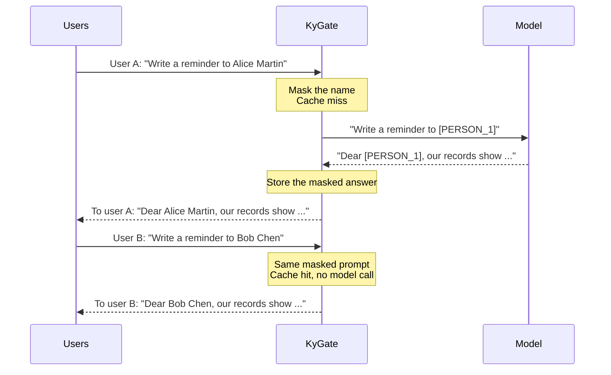
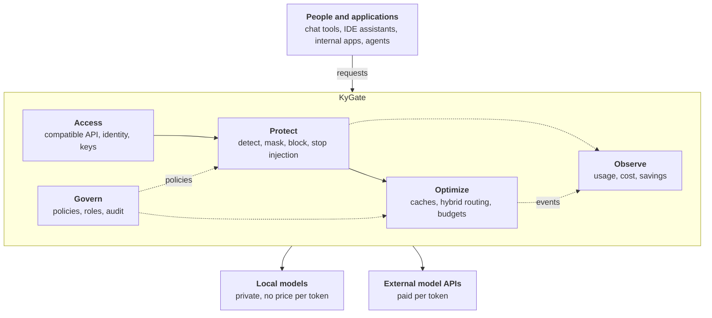
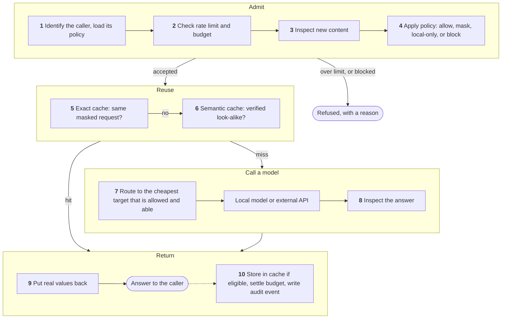
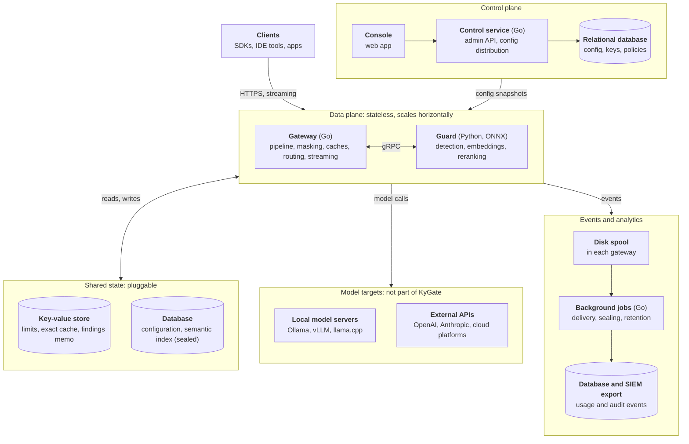

# KyGate: Functional and Technical Architecture

> **Status:** describes KyGate 0.1. Figures marked *target* or *estimate* are design assumptions to check with benchmarks. They are not measurements; measured figures say so.

**Contents:** [1 The idea](#1-the-idea-in-brief) · [2 Goals and principles](#2-goals-non-goals-and-principles) · [3 Functional architecture](#3-functional-architecture) · [4 Technical architecture](#4-technical-architecture) · [5 Scaling](#5-scaling-from-1-to-100000-users) · [6 Security](#6-security-architecture) · [7 Repository layout](#7-repository-layout)

## 1. The idea in brief

KyGate is an open-source, self-hosted **AI gateway**: one service that sits between a company's people and applications and the AI models they use, whether those are paid external APIs or models the company runs itself. Applications keep their existing OpenAI-style or Anthropic-style client code. They change only the base URL and the API key.

Every request passes through two jobs:

1. **Protect.** Keep sensitive data inside the company. KyGate finds secrets and personal data in a prompt, then blocks the request, masks the data, or forces the request to a local model, as the company's policy says. It also detects prompt-injection attempts and keeps an audit trail.
2. **Optimize.** Spend less per request. KyGate answers repeated prompts from a cache, answers look-alike prompts from a semantic cache, sends simple prompts to a local or cheaper model, and enforces budgets.

The two jobs belong in one product because each makes the other work better:

- **Masking makes the cache shareable.** A cached answer holds placeholders such as `[PERSON_1]`, never the real name. An answer first produced for user A can be reused for user B, and each of them gets their own names put back.
- **The sensitivity verdict drives routing.** A prompt that contains restricted data can be sent only to a local model, which is also the cheapest place to send it.



### The three cost ideas

| The idea | How KyGate does it |
|---|---|
| User B sends the same prompt user A already sent | **Exact cache.** The request is reduced to a 32-byte fingerprint (a keyed hash of the masked request). If the fingerprint is already known, the stored answer is returned and no model is called. |
| User B sends a look-alike prompt | **Semantic cache.** The last user message is converted to an *embedding*: a few hundred numbers that represent its meaning. A nearest-neighbor search finds earlier prompts with almost the same meaning, and a stricter second check confirms the match before the stored answer is reused. |
| A simple question does not need the paid model | **Hybrid routing.** A router looks at how hard the prompt is and what data it contains, then picks the cheapest target that can do the job: a local model, a low-cost API model, or a frontier model (the most capable and most expensive tier). |

The "compressed data" in the original idea is these fingerprints and embeddings: small representations that let KyGate recognize a prompt without storing or comparing the full text. Cached answers are also stored compressed.

There is a fourth saving that a gateway can destroy by accident: **the providers' own prompt caches**. Providers bill the repeated beginning of a conversation at a fraction of the normal input price, but only if that beginning is byte-identical each time. A gateway that rewrites prompts must keep it identical (section 4.3), or it raises the bill it was meant to lower.

### Where KyGate fits

Open-source gateways (LiteLLM, Portkey, Envoy AI Gateway and others) and detection libraries (Presidio, LLM Guard, NeMo Guardrails and others) already cover parts of this list. KyGate should reuse them where possible, Presidio for detection for example, and earn its place with the combination that is hard to assemble from parts: reversible masking that survives streaming and multi-turn conversations, a cache built to be shared safely between users, and routing that obeys data-sensitivity rules.

## 2. Goals, non-goals and principles

**Goals**

| # | Goal |
|---|---|
| G1 | **Drop-in.** Compatible with the OpenAI and Anthropic APIs, including streaming and tool calls. Adoption is a base-URL change. |
| G2 | **Self-hosted and open source.** Runs entirely inside the company's network, including air-gapped networks. Nothing leaves except the requests the policy allows. |
| G3 | **One codebase from 1 to 100,000 users.** A single binary on a laptop and a multi-zone cluster run the same code with different storage back ends. |
| G4 | **Safe by default.** If KyGate cannot inspect a request, it does not send it out. |
| G5 | **Measurable savings.** Every avoided or cheaper model call is counted in money, so the product can prove its value. |
| G6 | **Low overhead.** *Target:* under 100 ms added before the first token when a model is called, and under 15 ms to start answering a repeated request from cache. |
| G7 | **Usable from the first start.** A developer gives KyGate one or several provider keys, starts it, and points a client at it. Every release carries real traffic, and ships a console that shows what it did. |

**Non-goals**

- KyGate does not serve models. It talks to model servers such as Ollama or vLLM.
- It is not an agent framework or a retrieval (RAG) system. It protects and optimizes the model calls those systems make.
- It does not replace network data-loss prevention. It sees only the traffic routed through it (section 6.3).
- It does not ship or operate the extra infrastructure of very large fleets: a message bus, an analytics warehouse, a dedicated vector database, or coordination across regions. Every profile runs on SQLite, or on PostgreSQL and Valkey. The store interfaces stay open, so an installation that outgrows them can add such a back end, but the project does not build, test, or support one (section 5.7).

**Design principles.** Most later design choices follow from these seven.

1. **The Guard detects; the Gateway enforces.** The ML service only reports what it found. Masking, blocking, and the table that maps placeholders to real values stay in the gateway process.
2. **Security fails closed; optimization fails open.** When detection is unavailable, the request is refused or kept local. When a cache or the router is unavailable, the request goes ahead without that optimization.
3. **Real sensitive values live only in request memory.** They are never written to a cache, a log, a queue, or a database.
4. **The provider sees a stable conversation.** Masking is deterministic and append-only, so an earlier turn looks byte-identical every time it is sent again.
5. **Every stateful dependency is pluggable.** Each one has an embedded implementation for one user and a clustered one for 100,000.
6. **Measure before enforcing.** Detection, the semantic cache, and routing each have a mode that only reports what they would have done.
7. **Start light; every option is added by configuration.** One binary holds every capability of the gateway and the control service. A first start needs nothing beside it and uses only what the starter policy turns on. Every other capability (the Guard, a database server, a shared cache, a key-management service, single sign-on, SIEM export, traces) stays off until a command, a setting, or a file turns it on, and adding one never means a different binary. The Guard is the one separate install, because it is Python and its models are large downloads. The README lists each option with what it needs and how to turn it on.

## 3. Functional architecture

### 3.1 Who uses it

| Actor | What they do |
|---|---|
| End user | Uses chat tools, IDE assistants, and internal apps as before. Sees faster answers on cache hits and a clear message when a request is blocked. |
| Application developer | Points an SDK at KyGate with a virtual key. May pass hints in headers: skip the cache, pin a model, tag a request. |
| Security officer | Writes data policies, reviews findings, sends audit events to the company's security monitoring system (SIEM). |
| Platform administrator | Connects providers and local models; manages teams, keys, and deployments. |
| Finance or team lead | Sets budgets; reads cost and savings reports. |

In a Solo installation one developer plays all of these roles: they add their own provider keys, use the gateway, and read the reports.

### 3.2 Functional blocks

Three blocks sit on the request path, in this order: Access, Protect, Optimize. Two blocks work across all requests: Govern supplies the policies, and Observe collects what happened.



The tables list what each block does.

**Access**

| ID | Capability |
|---|---|
| AC-1 | OpenAI-compatible and Anthropic-compatible endpoints: chat, streaming, tool calls, embeddings, model list |
| AC-2 | Virtual API keys per user, team, or application. Real provider keys never leave KyGate |
| AC-3 | End-user identity: single sign-on (OIDC) for people; a signed user token forwarded by applications, so that usage is attributed to a person even behind a shared application key |
| AC-4 | Hierarchy: organization → team → project → user or key |
| AC-5 | Provider connections: one or several real keys per provider, and the addresses of local model servers. Supplied through environment variables, the command line, or the admin API and console (section 3.7) |

**Protect**

| ID | Capability |
|---|---|
| PR-1 | Fast detectors: secrets (API keys, tokens, private keys), identifiers with checksums (payment cards, IBANs), company dictionaries (project code names, customer lists) |
| PR-2 | ML detectors: names, addresses, and other personal data that can only be recognized in context; several languages |
| PR-3 | One action per data type: allow, mask (reversible), redact (permanent), block, local-only, alert. While the router runs in shadow mode, local-only refuses a request aimed at an external target |
| PR-4 | Reversible masking with *rehydration* (putting the real values back), including in streamed answers and tool calls |
| PR-5 | Prompt-injection detection on untrusted content: user turns, tool results, retrieved documents |
| PR-6 | Output inspection: secrets and data-exfiltration patterns in model answers |
| PR-7 | Monitor mode (report only) and enforce mode, per policy |
| PR-8 | A rule for content KyGate cannot read yet (images, files, audio): allow, block, or local-only. Text extraction from images comes later |

**Optimize**

| ID | Capability |
|---|---|
| OP-1 | Exact response cache, for chat and embedding requests |
| OP-2 | Protection of provider prompt caches through stable prefixes. Later, cache markers added automatically where a provider needs them |
| OP-3 | Semantic response cache, with verification and a shadow mode. Narrow and without the Guard (one key, hard checks); wider scopes would need a second-check model |
| OP-4 | Hybrid routing: local-first for simple prompts, model tiers, fallback when a provider fails |
| OP-5 | Rate limits and budgets per organization, team, user, and key, with a soft limit (downgrade) and a hard limit (refuse) |
| OP-6 | Coalescing: identical requests that arrive together share one model call |
| OP-7 | Prompt compression; batch processing of non-urgent jobs at provider batch prices | Later |

**Govern**

| ID | Capability |
|---|---|
| GV-1 | Policies as versioned YAML files; later an admin API and administration in the console |
| GV-2 | Administrator roles and single sign-on; automatic user provisioning (SCIM) later |
| GV-3 | Audit trail of every request and every policy decision; export to a SIEM; tamper evidence |
| GV-4 | Data handling controls: retention periods, purge API, region pinning |

**Observe**

| ID | Capability |
|---|---|
| OB-1 | Usage and cost by organization, team, user, application, and model |
| OB-2 | Savings report: money avoided, compared with sending everything to the requested model. Exact-cache, semantic-cache, coalescing, and (shadow) routing savings |
| OB-3 | Security report: findings by type, blocked requests, main sources. Fast-detector findings, ML findings, and threats |
| OB-4 | Quality signals: semantic-cache false hits, routing quality samples, user feedback on bad answers |
| OB-5 | Metrics, traces, and health endpoints |
| OB-6 | Console: a web page that shows the reports above. Reports for everyone, and administration for signed-in roles (section 3.8) |

### 3.3 The life of a request



Three points about the order:

- **The caches come after masking** (steps 5 and 6 after step 4). They work on masked text, so entries hold no real values, and two prompts that differ only in a name share one entry.
- **Step 9 applies to cache hits too.** A stored answer is in placeholder form and receives the caller's own values.
- **In monitor mode,** steps 4, 6, and 7 record the decision they would have taken and change nothing.

### 3.4 Cache rules

This section answers the central question of the original idea: when is it safe to give user B an answer that was produced for user A?

**Exact matches are safe to share across the organization.** A model's answer depends only on the request it receives. To hit an exact entry, B must send the same masked request as A did, so B learns nothing that B could not get by calling the model directly. The default scope is the organization. The one thing B can learn is that someone already asked the same question; a department that minds can narrow its scope to the team or the user.

**Look-alike matches need tighter rules.** B only has to send a *similar* prompt, so without controls B could receive an answer that repeats details A typed. A wrong match also returns a wrong answer. The rules are:

1. **Only the last user message is compared by meaning.** Everything before it (system prompt, earlier turns, tool definitions, model, settings) must match exactly. A bare "yes, do it" never matches across different conversations.
2. **Only short, plain messages qualify:** up to 256 tokens by default, with no masked entities, in a request that declares no tools. Long prompts are almost always unique. Requests outside these limits still use the exact cache.
3. **Matching has two stages.** A nearest-neighbor search proposes candidates; a stricter model (a cross-encoder) and hard checks confirm. The hard checks reject a candidate when numbers, negations, code identifiers, or the language differ. A single similarity threshold cannot tell "capital of France" from "capital of Germany". Without the Guard, the cross-encoder is missing, so the hard checks are stricter (see *The semantic cache without the Guard* below).
4. **Admission is guarded.** An answer enters the shared semantic cache only after the answer itself has been scanned and found clean, and never when the prompt was flagged for injection. For wide scopes, an entry can be required to come from several different users before it is shared.
5. **The default scope is narrow:** the application, meaning one group of virtual keys with the same system prompt and the same audience. Team and organization scopes are opt-in. Until applications exist, and always without the Guard, the scope is one virtual key.
6. **Shadow mode comes first.** The semantic cache starts by logging the hits it would have served. A sample is compared with real model answers to measure the false-hit rate before serving is switched on.

**Requests that are never cached**

- The answer depends on state KyGate cannot see: conversations stored by the provider, references to uploaded files, provider-side tools such as web search or code execution.
- The answer is not a clean completion: an error, a truncated answer, a refusal, or an answer that output inspection changed or blocked.
- The same user repeats the same request within a short time, when the policy keeps this rule (`cache.exact.repeat_window`). Such a repeat is usually a "regenerate" click, and the user expects a new answer. A developer whose goal is spending less switches the rule off, as the starter policy does; a repeat inside the window does not restart it.
- The client or the policy says so, with a no-cache header or a disabled scope.

Entries expire after a time-to-live (TTL), can be tagged and purged by tag, and can be reported as wrong by a user, which removes them.

**How long an entry lives.** An entry outlives a restart of the gateway. It is held in the shared store in Team and Enterprise, and in a local file in Solo (section 4.5). The TTL is therefore the real lifetime of an answer, and a long TTL has two effects worth knowing:

- A request that names a model alias, such as a "latest" name, keeps receiving the answer of the model the alias pointed to when the entry was stored. A pinned model name does not have this effect.
- The cache version is part of the fingerprint (section 4.5): it covers the policy settings that can change a masked request, which are the mode, the data rules, and the exact-cache scope. Changing one of them makes every earlier entry unreachable; those entries stay in the store until they expire or are evicted. Editing anything else, such as a comment, a TTL, a size, or the audit settings, keeps every stored answer.

**The semantic cache without the Guard.** The semantic cache saves money, so it does not need the Guard. Without a second-stage model, a wrong match cannot be confirmed by a model, so it is kept narrow:

- *Scope:* one virtual key. A wrong answer reaches only the key that asked the first question.
- *Eligibility:* a chat or messages request in which the detectors found nothing of any type, with nothing unreadable, no tools, and a plain-text last user message of up to 256 tokens. Everything before that message must be identical.
- *Second stage:* hard checks in Go instead of the cross-encoder. They reject a candidate unless both messages have the same language, numbers, negations, code identifiers, and content words, and, when a word gives a direction or an order ("to", "than", "before"), the same word order. Messages that differ only in case, punctuation, word order, filler words, and plurals match; "what's the capital of france" matches "What is the capital of France?". A synonym does not match.
- *Threshold:* strict, 0.95 cosine similarity by default and 0.80 at the lowest.
- *Admission:* the fast detectors find nothing in the answer.
- *Embeddings:* from a provider connection that the policy names, such as a local Ollama, so no Python is needed. The policy names the connection, never a key.
- *Lifetime:* 7 days by default, shorter than exact entries, because a look-alike match can also be wrong.
- *Shadow mode first:* each shadow hit is compared with the real answer by embedding similarity (0.90), which gives the console an estimate of the false-hit rate. Two good answers can be worded differently, so this estimate errs towards counting disagreements.

With the Guard, the cross-encoder joins the hard checks, and wider scopes become possible.

### 3.5 Routing rules

The router answers one question: what is the cheapest target that is *allowed* to take this request and *able* to answer it well? It decides in this order.

1. **Hard constraints, never traded for cost.**
   - Capability: context size, tool calling, vision, structured output.
   - Data: restricted data goes only to local or private targets; the region and data-retention terms of each target are respected.
   - Permission: the caller's list of allowed models; an explicit pin set by the application.
2. **Budget state.** Past the soft limit, the router prefers a cheaper tier. Past the hard limit, it refuses or stays local.
3. **Difficulty.** A classifier estimates the lowest tier likely to answer well: `local`, `economy`, `standard`, or `frontier`. A lower reasoning-effort setting on the same model, where the provider offers one, is another step on the same scale; it lowers cost without changing the model.
4. **Target within the tier.** Health, rate-limit headroom, latency, and price. A busy local pool queues a request briefly, then overflows to an external tier. Restricted data never overflows: it waits or is refused.
5. **Fallback.** If the target fails before the first byte has been sent to the client, the next target in the chain is tried.

Three rules keep routing honest:

- **Decide once per conversation.** Changing model in the middle of a conversation discards the provider's prompt cache, which is kept per model, and can lose the model's earlier reasoning. The router decides when a conversation starts and stays with that choice.
- **Never downgrade silently.** Response headers name the model that answered and the reason. An application can pin a model.
- **Treat difficulty as a prediction.** A wrong "simple" costs a bad answer. Routing starts in shadow mode, and a sample of locally answered prompts is compared with frontier answers before enforcement.

Policies never name a model. They refer to tiers, and a model catalog maps tiers to current models, because provider model names change several times a year.

### 3.6 Policy model

Policies attach to the hierarchy organization → team → project → key. For security settings, the most restrictive level wins. For budgets and routing preferences, the most specific level wins.

```yaml
# Illustrative only. The real schema is in docs/deployment.md and the starter policy.
kind: Policy
scope: org                        # org | team | project | key
mode: enforce                     # monitor = record decisions, change nothing
data:
  on_guard_unavailable: block     # block | local_only | fast_detectors_only
  entities:
    SECRET:                 { action: block }
    CREDIT_CARD:            { action: mask }
    PERSON:                 { action: mask, detection: model }   # model: never a list alone (section 4.4)
    EMAIL:                  { action: mask }
    AMOUNT:                 { action: allow }       # masked numbers break calculations
    dict/project-codenames: { action: local_only }
threats:
  prompt_injection: { action: block, min_score: 0.90, segments: [user, tool_result] }
output:                           # output inspection (PR-6): alert | remove | block | allow
  secrets:        { action: remove }
  images:         { action: remove }    # images from sites the request did not name
  protected_urls: { action: remove }    # addresses that carry a placeholder
  links:          { action: alert }
  allowed_domains: [docs.example.com]
cache:
  exact:    { scope: org, ttl: 30d, persist: true, repeat_window: 0s }   # persist: keep entries on disk (Solo)
  semantic: { enabled: true, scope: application, ttl: 7d, mode: shadow, max_prompt_tokens: 256,
              embeddings: { connection: local-ollama, model: nomic-embed-text } }
routing:
  mode: shadow                    # off | shadow (records only); enforcement after a quality check
  tiers: [local, economy, standard, frontier]
budgets:
  monthly_usd: { soft: 800, hard: 1000, at_soft: cheaper_tier, at_hard: reject }
audit:
  capture_payloads: none          # none | masked
  on_spool_full: block            # block | drop_and_alert
```

### 3.7 First run: from a provider key to a working gateway

The path is the same in every profile (goal G7). Options add to it and take nothing away.

```text
export ANTHROPIC_API_KEY=...     # one or several real provider keys (ANTHROPIC_API_KEY_<SUFFIX> for more)
export OPENAI_API_KEY=...        # OPENAI_API_KEY_<SUFFIX> for more
kygate serve                     # the first start prints a virtual key, an admin token, and the console address
```

1. **Give KyGate the real keys.** One key or many: keys for several providers, and several keys for one provider. A local model server is connected the same way, by its address.

   | Way to supply a key | Where the key is kept |
   |---|---|
   | Environment variables, under the names the providers' own SDKs read | Gateway memory only; KyGate does not write it to disk |
   | A command-line command that adds, lists, and removes named keys | The configuration store, encrypted (section 4.9) |
   | The admin API and the console | The configuration store, encrypted |

   A key never goes into a policy file, because policy files are meant to live in Git.

2. **Start KyGate.** A first start asks no questions. With an empty data directory, KyGate creates a master key, one organization, a starter policy, one virtual key, and one admin token. The virtual key and the admin token are shown once and stored as hashes, so a lost one is replaced, not recovered: `kygate key create` prints a new virtual key, and `kygate admin-token reset` a new admin token. If no provider key and no local model server is configured, KyGate says so at start; it does not wait for the first request to fail.

3. **Point clients at it.** An application changes its base URL and replaces its provider key with the virtual key (goal G1). More virtual keys are created from the command line or the admin API. While the router runs in shadow mode, every request goes to the model it names.

4. **Open the console** to see what was spent, saved, and found (section 3.8).

5. **Optionally, keep it running.** `kygate service install` runs KyGate in the background, so that closing the terminal does not stop it: a scheduled task started at logon on Windows, a systemd user unit on Linux. Neither needs administrator rights. KyGate restarts if it stops unexpectedly, and runs on the same data directory. A provider key that exists only in a terminal is not visible in the background, so install asks the user to store it (`kygate provider add`) rather than copy it to disk.

**The starter policy.** A first run must protect and save without tuning, and must not break prompts. The starter policy therefore enforces only what the fast detectors find with high precision: secrets are blocked, and identifiers that carry a checksum are masked. It turns the exact cache on, keeps its entries on disk for 30 days so that they survive a restart (section 4.5), switches the regenerate rule off, writes out the semantic cache in shadow mode but off until an embeddings model is named, and allows everything else. It is an ordinary policy file, which the user edits or replaces, and each of its choices is written in the file.

**Several keys for one provider.** A conversation stays on the key that served its first turn, because providers keep prompt caches per account or workspace (section 4.6). A key that is rate-limited or rejected is skipped, and the next key is tried before the first byte is sent to the client.

**Upgrades keep an installation working.** Provider keys, virtual keys, policy files, and stored data carry over from one version to the next; storage changes are migrated at start. New capabilities arrive switched off or in monitor mode (principle 6), so an upgrade does not change what an installation does until its owner turns them on. An installation runs without the Guard until its policy names a data type or a threat that needs ML detection. In the same way, a policy file written before the exact cache could be kept on disk does not name that setting, so that installation keeps its cache in memory until its owner adds the setting. Such a file also keeps a 24-hour TTL and the 30-second regenerate rule, and has no semantic cache, until its owner sets them.

### 3.8 The console

The console is the page where a user checks what KyGate did: what was spent, what was saved, and what was found. It ships with the binary, because a gateway that carries real traffic has to show its effect before anyone can trust its savings (goal G5) or tune its policy (principle 6).

| Area | Who uses it | What it shows | What it can change |
|---|---|---|---|
| **Usage, savings, findings** | One developer, or a small team that shares one installation | Requests, tokens, and cost per day, per model, and per virtual key. Exact-cache and semantic-cache hits and the money they avoided; in shadow mode, the hits the semantic cache would have served and how often they differed from the real answer. Findings by data type and the action taken, including what monitor mode would have done. Recent requests, as metadata. The state of each provider key and local model server | Nothing. Keys and policies are managed with the command line, the admin API, and policy files |
| **The Guard** | The same people, tuning the policy | ML findings by data type and language. Injection attempts, and answers stopped by output inspection. The complete security report. The state and latency of the Guard | Nothing |
| **Administration** | Platform administrators, security officers, team leads, and finance, each signed in and limited by role | Every report by organization, team, project, and user. Budgets against their soft and hard limits. Routing: the model requested and the model served, the share of each tier, routing savings, and shadow-mode results | Provider keys, virtual keys, policies, budgets, teams, roles, retention, and purges, through the admin API |
| **Fleet and audit** | The same roles, on a larger installation | The state of every gateway, Guard, and store. Event delivery lag and SIEM export status. Audit integrity checks. Quality signals (OB-4). Long time ranges, from PostgreSQL within the retention period | SIEM export destinations and user provisioning |

Without single sign-on the console is read-only on purpose: keys and policies change on the machine itself, through the command line and policy files, or through the admin API with the admin token, so a browser page cannot change a security setting.

These rules always hold:

- **The console shows no more than the events hold.** Events carry types and counts, never values (section 4.8). Prompt and answer text appears only when the policy captures masked payloads, and then only in masked form.
- **Provider keys are never displayed.** The console shows a key's name, its provider, and its state.
- **It is protected from the first start.** In Solo it listens on the local machine only, unless configured otherwise, and asks for the admin token. With single sign-on, people sign in with single sign-on and see what their role allows: a team lead sees their team, not the organization.
- **It is one console in one codebase.** The Solo page is the same web app with fewer pages. It reads the same reports through the store interface: from SQLite in Solo, and PostgreSQL in Team and Enterprise.
- **The numbers do not depend on a browser.** The reporting API behind the console serves the same figures to scripts and dashboards.

## 4. Technical architecture

### 4.1 Overview

**Editions.** One codebase builds two editions. KyGate Community is this public repository, under Apache 2.0. KyGate Enterprise adds single sign-on and roles, SCIM provisioning, the master key in a key-management service, and the tamper-evident audit ledger with SIEM export; its sources are built with `-tags enterprise`. Where this document describes those four capabilities, it describes the Enterprise edition. The Community edition answers a request for one of them with an explicit error, never with a silent no-op.



Inside the data plane, only the Gateway talks to the shared stores, the model targets, and the event pipeline. The Guard is called by the Gateway and by nothing else.

| Component | Built with | Responsibility | State |
|---|---|---|---|
| **Gateway** | Go | The request path: protocol handling, identity, limits, fast detectors, masking and rehydration, caches, routing, streaming to and from models, event emission | None of its own: a configuration snapshot and a small cache in memory |
| **Guard** | Python, ONNX Runtime | ML inference only: personal-data detection, injection classifier, embeddings, reranking | None |
| **Control service** | Go, same binary | First-start setup, admin and reporting API, serving the console, configuration store, pushing configuration to gateways, key management | Relational database |
| **Background jobs** | Go, same binary, inside the gateway and control roles | Event delivery from the spool, retention and purges, sealing the audit ledger, SIEM export | None |
| **Console** | Plain JavaScript web app with no build step, embedded in the Go binary | Reports, and administration for signed-in roles (section 3.8) | None |
| **Model targets** | Not part of KyGate | External APIs; local servers that speak the OpenAI API (Ollama, vLLM, llama.cpp) | Not applicable |

One Go binary runs as `--role=all`, or as `gateway` or `control`. A small installation runs one process; a large one scales the gateways separately. A separate `worker` role is a possible later split; today the background jobs run inside the gateway and control roles.

With `--role=all` the control role runs inside that one process, so a Solo installation has its console without a second service. The control role holds first-start setup, the configuration store, the reporting and admin APIs, the console, retention, and the audit ledger's sealer. In the Team profile it runs apart from the gateways (`--role=control`).

**Why Go and Python.** The gateway holds thousands of long-lived streaming connections and must stay small and predictable, which is where Go is strong. Detection models and their tooling (Presidio, tokenizers, model export) live in Python. The gRPC contract is the boundary between them: the Guard can be rewritten, or replaced by a dedicated inference server, without touching the gateway. gRPC is chosen for its typed contract, deadlines, and cancellation. Serialization speed is not the reason, because inference time dominates.

### 4.2 The gateway pipeline

Each request runs through ordered stages. The last column says what a stage does when it cannot do its work.

| # | Stage | What happens | On failure |
|---|---|---|---|
| 1 | Ingress | Enforce size limits; parse the OpenAI or Anthropic wire format into one internal request model | Reject |
| 2 | Identity | Resolve the key or user token to a caller and its policy, from the in-memory snapshot | Reject |
| 3 | Limits | Check rate limits; reserve budget | Per policy |
| 4 | Inspect | Run fast detectors in-process; send content not seen before to the Guard | **Closed** |
| 5 | Enforce | Merge findings; apply policy actions; build the masked request and the in-memory value map | **Closed** |
| 6 | Cache | Exact lookup, then semantic lookup if eligible | Open: skip |
| 7 | Coalesce | Join an identical request that is already in flight | Open: skip |
| 8 | Route | Constraints, then tier, then target | Constraints closed; scoring falls back to the requested model |
| 9 | Upstream | Translate to the target's format; call; retry or fall back before the first byte | Fallback chain, then error |
| 10 | Respond | Inspect output in a sliding window; rehydrate; write the caller's wire format | Remove the part, or stop the stream (per the output action) |
| 11 | After | Scan the answer and admit it to the cache; settle budget; emit the usage and audit event | Open, except audit (section 4.8) |

**Native and translated modes.** In *native* mode a request goes to the same API family it arrived in. The gateway rewrites only the fields that carry text and passes every field it does not understand through unchanged. In *translated* mode a request crosses families, for example an Anthropic-style request served by a local OpenAI-compatible model. Translation loses features, so the router considers a translated target only when the model catalog says that target supports every feature the request uses.

### 4.3 Masking and rehydration

This is the part most likely to go wrong, so its rules are explicit. A *segment* is one piece of text in a request: the system prompt, one message, one tool result.

**Detection produces findings; the gateway applies them.** A finding is a segment, a data type, start and end offsets, a score, and the detector that produced it. Findings from the fast detectors and from the Guard are merged in one place, with a fixed rule for overlaps. Offsets in the contract are UTF-8 byte offsets, because Python counts characters and Go counts bytes.

**Placeholders.** Each distinct value becomes a typed, numbered placeholder such as `[EMAIL_2]`. The same value always gets the same placeholder within a conversation, so the model can still tell that two mentions refer to the same person. Numbers are assigned in order of first appearance.

**Masking is deterministic and append-only.** The same conversation must produce the same masked text every time it is sent, turn by turn:

- A value found in a later turn is never applied backwards to earlier turns. Earlier turns keep the form in which they were first sent.
- Findings are memoized per segment, under a keyed hash of the content, and reused for the life of the conversation. ML scores are not exactly reproducible from one batch to the next, so stability comes from the memo and not from running the model again.
- Reasoning blocks, signatures, and other opaque or encrypted content pass through untouched in both directions. A reasoning summary shown to a user may therefore contain placeholders.

Two things depend on this stability. Provider prompt caches match on an exact prefix, so one changed byte early in a conversation makes everything after it full price. And current Anthropic models tie each reasoning block to the exact conversation that came before it: a request that replays such a block after earlier turns have changed can be rejected (see Anthropic's [preserved thinking](https://platform.claude.com/docs/en/build-with-claude/preserved-thinking.md) documentation). If a mismatch still happens, for example because a policy change took effect in the middle of a conversation, the provider adapter retries once using the recovery the provider documents.

**The value map lives in gateway memory, for one request.** Clients resend the full conversation on every call, so the map is rebuilt from the request itself each time and nothing sensitive has to be stored. APIs that keep the conversation on the provider's side break this assumption. In the first versions, KyGate refuses them when masking is on.

**Rehydration in streams.** A placeholder can arrive split across stream events (`[EM`, `AIL_`, `2]`). A small state machine holds text back only while it could be the start of a placeholder, then emits either the real value or the text as it was. Inside tool-call arguments the value is JSON-escaped. A placeholder the model has altered beyond recognition is passed through and counted in a metric.

**The cache stores the placeholder form.** Rehydration happens after the cache, per request, from the caller's own value map. This is what makes one entry reusable by different users.

**Masking has a cost.** It removes information the model may need. Masked amounts cannot be added up. A masked name loses its gender, which matters in some languages. "Alice" and "Alice Martin" may become two different people. So actions are set per data type, quantities are not masked by default, and monitor mode exists to tune a policy on real traffic before enforcing it.

**Embedding requests are not masked,** because masking would change the vectors. The policy for them is allow, block, or local-only.

### 4.4 The Guard service

```proto
// api/proto/guard/v1/guard.proto (sketch: the full contract, with the Embed, Rerank, and Info messages, is that file)
syntax = "proto3";

service Guard {
  // Findings for segments the gateway has not seen before.
  rpc Inspect(InspectRequest) returns (InspectResponse);
  // Vectors for the semantic cache and the router. The input is already masked.
  rpc Embed(EmbedRequest) returns (EmbedResponse);
  // Second-stage check of semantic cache candidates.
  rpc Rerank(RerankRequest) returns (RerankResponse);
}

message Segment {
  string id = 1;           // position in the request, for example "messages.3.content.0"
  Role role = 2;           // SYSTEM, USER, ASSISTANT, TOOL_RESULT
  ContentKind kind = 3;    // PROSE, CODE, STRUCTURED
  bool untrusted = 4;      // run threat detectors on this segment
  string text = 5;
}

message Finding {
  string segment_id = 1;
  string entity_type = 2;  // PERSON, EMAIL, SECRET, ...
  uint32 start = 3;        // UTF-8 byte offsets, end exclusive
  uint32 end = 4;
  float score = 5;
  string detector = 6;     // name and version
}

message Threat {
  string segment_id = 1;
  string type = 2;         // PROMPT_INJECTION, ...
  float score = 3;
}

message InspectRequest  { repeated Segment segments = 1; string policy_version = 2; }
message InspectResponse { repeated Finding findings = 1; repeated Threat threats = 2; }
```

- **Runtime.** ONNX Runtime with quantized models; CPU by default, GPU optional. Each instance reports ready only after its models are loaded. Batching requests from different callers for a few milliseconds, and warm-up before ready, are planned but not built.
- **Two levels.** The base Guard finds what its *recognizers* list: terms and patterns from a configuration file. It needs no model and no download, and finds only what is listed. ML detection is the second level, added on purpose: the inference software is an optional extra of the package, and the models come as *model packs* that an operator downloads with an explicit command. Neither KyGate nor the Guard downloads anything on its own.
- **Models.** A model pack names its models, their size, and their licenses, which the command shows before downloading, and is pinned by digest, which it checks before use. The Guard loads packs from a local model directory, so an air-gapped installation copies the directory and the same checks apply. Every default model must carry a permissive license; which model goes in the default pack is decided by benchmarks.
- **Which level covers each type.** The Guard reports, for each data type it finds, whether a list or a model covers it. The gateway shows it in the start banner and the console, and `kygate policy check` warns when a type the policy acts on is covered by a list alone. A policy can require a model for a type (`detection: model`): when the Guard has no model for it, the request follows `on_guard_unavailable`. A list never stands in for a model silently, because a list cannot find a name it has never seen.
- **What is scanned.** Injection detection runs only on untrusted segments: user turns, tool results, retrieved documents. The operator's own system prompt is instructions by design. Prose gets the full ML detectors. Source code and tool output get the fast detectors by default, because secrets are the main risk there and name detection raises many false alarms.
- **Long inputs.** Sliding windows. The gateway sets a deadline on every call; a missed deadline counts as a Guard failure and follows the fail-closed rule. Because findings are memoized, each turn costs only its new content. A conversation is never rescanned from the start.
- **Placement.** In a small installation the Guard runs next to the gateway and they talk over a Unix socket, or over TCP on the loopback address, which is the default because it works the same on Windows. In a large one it is a separate autoscaled pool reached over mutually authenticated TLS. A gRPC client keeps one long-lived connection and Kubernetes balances per connection, so the gateway must balance per call itself, with a headless service and client-side balancing or with a service mesh. Otherwise one Guard instance receives all the traffic. *As built:* gRPC round robin over the addresses of a headless service, a one-minute maximum connection age on the Guard so new instances are found, and mutual TLS.
- **Extension.** New recognizers (pattern, dictionary, model) are added by configuration. A hook that calls a company's existing data-loss-prevention engine is planned.

### 4.5 Cache internals

**Fingerprints**

- *Request fingerprint:* HMAC-SHA-256, keyed with a per-organization secret, over a canonical form of the cache scope, the requested model name, the masked system prompt and messages, the tool definitions, every setting that changes the answer, and the cache version. It excludes the streaming flag and request metadata.
- *Cache version:* a digest of the policy settings that can change a masked request: the mode, the data rules (with dictionary files as loaded), and the exact-cache scope. Events still record the version of the whole policy file.
- *Context fingerprint:* the same, without the last user message.
- *Semantic vector:* the embedding of the masked last user message, labeled with the embedding model.

The hash is keyed so that someone who can read the cache store cannot test guesses ("was this prompt asked?"), and so that two organizations can never collide.

**Lookup order.** In-process cache (small, short-lived), then the exact store, then the semantic index filtered by scope and context fingerprint, then verification. The exact store is the shared store in Team and Enterprise, and a local file in Solo.

**The exact store in Solo.** A cache held only in process memory is empty after every restart. On a laptop, each day would start by paying again for answers that were already stored the day before. In Solo the exact store is therefore a local SQLite file, `cache.db`, in the data directory. It sits behind the same store interface as the Valkey driver (principle 5), and it holds entries in the same form as every other store: placeholder text, compressed, then encrypted.

- *Its own file.* The cache is kept apart from the configuration and event database. Cache entries are rewritten often and can be thrown away at any time; the other data cannot. Deleting the file while KyGate is stopped is a safe purge.
- *Reads.* The file is read only when the in-process cache misses, and the entry found is copied into memory. This is a cache-store read, like a read of the shared store in the other profiles. Configuration still comes from the in-memory snapshot (section 4.9).
- *Writes.* Entries are written in the background, in small batches, so a response never waits for the disk. A crash loses at most the last few entries.
- *Failure.* The cache fails open (principle 2). A disk error, a damaged file, or an entry that cannot be decrypted because the master key changed counts as a miss. None of them stops KyGate from starting or from serving: it runs on the in-process cache alone, as it does in the other profiles when the shared store is down (section 5.4).
- *Cleanup.* A background job deletes expired entries and keeps the file under its size limit, removing the least recently used entries first.
- *Settings.* `cache.exact.persist` turns the file on, and `cache.exact.max_disk_mb` limits its size (default 1024). `cache.exact.max_size_mb` stays the memory budget of the in-process cache. The starter policy turns `persist` on. A policy file that does not name the setting keeps the cache in memory only, so an upgrade changes nothing (section 3.7). *Estimate:* 1 GB holds 350,000 to 500,000 entries of 2 to 3 KB.

**Entries.** An answer is stored once, in the internal model and in placeholder form, compressed (zstd) and encrypted with a per-organization key. It is replayed as plain JSON or as a stream in the caller's wire format, whichever was asked for. Metadata records the original token usage, so that a hit can be counted as money saved. A response header reports `hit`, `miss`, or `bypass` (`X-KyGate-Cache`), and the kind of hit, `exact` or `semantic` (`X-KyGate-Cache-Kind`). The response body is never changed, so unmodified clients keep working.

**Fingerprint normalization.** IDE assistants put volatile details into prompts, such as cursor positions and timestamps, which defeats caching. Per-client profiles remove such fields *from the fingerprint only*. The request sent to the model is not changed.

**Hints from applications.** Headers let an application skip the cache, narrow the scope, add tags for a later purge, or name the text to compare by meaning. The last one matters for retrieval (RAG) applications, whose final message is mostly retrieved documents: they can pass the user's original question as the text to match.

**Coalescing.** Identical requests that arrive while the first is still running wait for it and share its answer. Followers of a streamed answer first receive what has been produced so far, then follow live. The model call is detached from the first caller's connection, so a disconnect does not fail the others. Coalescing works per gateway instance at first, and across instances later through the shared store.

**The semantic index in Solo.** Entries sit in a table of `cache.db`, grouped by context fingerprint, each sealed like an exact entry: the masked last message, its normalized embedding, and the masked answer. A lookup reads the newest 200 entries of one context and compares them after decryption, so the file holds neither text nor vectors in readable form. Writes happen in the background, and a cleanup keeps at most `cache.semantic.max_entries` (default 20,000) and deletes expired ones. The size limit of the file (`max_disk_mb`) covers both caches. A vector from another embedding model has another length and never matches.

**Semantic index (Team and Enterprise).** There is one collection per embedding model, so changing the model starts a new index. Organization, scope, and context fingerprint are indexed filter fields; a collection per tenant does not scale. Vectors are quantized to save memory. An index entry points to the answer body by ID, and an entry whose body has expired is removed when it is found.

### 4.6 Router internals

- **Model catalog.** One record per target: API family, capabilities, context size, price per token class (input, output, cached input), tier, hosting (local, private cloud, external), region, data-retention terms. Policies and the router read the catalog. Nothing else names a model. A built-in catalog ships with the binary and covers the common providers, so cost is reported from the first request. A local file extends or overrides it. A model the catalog does not know is still served in native mode: it is treated as an external target, its tokens are counted, and its cost is reported as unpriced.
- **Difficulty classifier.** Rules first (length, code, required capabilities), then a small classifier over the embedding already computed for the semantic cache, so routing adds no extra model call.
- **Target health.** Per target and per credential: an error rate with a circuit breaker, a moving average of latency, and rate-limit headroom read from provider response headers.
- **Affinity.** A conversation stays on the same model and, where possible, on the same provider credential and region, because providers keep prompt caches per account or workspace.
- **Local capacity.** A local pool has a fixed size. The router tracks its in-flight requests and applies the queue-then-overflow rule from section 3.5.

### 4.7 Limits and budgets

- **Reserve, then settle.** The real cost of a call is known only when the answer ends. Before the call the gateway reserves an estimate: the input size plus the maximum output requested. Afterwards it settles with the usage the provider reports. Without reservation, many parallel requests could each pass a check that sees the same unspent budget.
- **Counters and ledger.** Counters live in the shared store and are updated atomically in one round trip. The durable record is the usage ledger built from events, and counters can be rebuilt from it.
- **Usage data.** The provider's reported usage is the billing truth, including cached-input tokens. Token estimates are used only for reservation. For OpenAI-style streams the gateway asks for the usage block, which those APIs send only on request.
- **At scale.** Each gateway instance leases a slice of a budget for a few seconds and counts locally, which removes the shared store from most requests.
- **Cache hits cost nothing** and are recorded with the cost they avoided.

### 4.8 Usage and audit pipeline

Every request produces one event: who (organization, team, user, key), what (model requested and served, token counts by class, cost, cost avoided), which controls fired (finding types and actions, as counts and never as values), the cache result, timing per stage, the policy version, and a request ID.

- **Durability.** Events are written first to an append-only spool on local disk, then delivered. A crashed gateway loses nothing that reached the spool. Delivery is at-least-once, with event IDs that let the receiving side drop duplicates.
- **A full spool.** Policy decides: refuse new requests, for installations driven by compliance, or drop events and raise an alert.
- **Payloads are not logged by default.** Prompt and answer text can be captured in masked form only, encrypted, with a retention period. Logging raw prompts would rebuild the leak KyGate exists to prevent.
- **Destinations.** The database (SQLite or PostgreSQL), and SIEM export (webhook, syslog, OpenTelemetry), which also feeds a company's own archive or analytics warehouse; KyGate does not run one (section 5.7). *Tamper evidence, as built:* a separate ledger of keyed digests chained by hash, events signed by their gateway, retention and purges recorded in the ledger, and SIEM export of webhook, syslog, and OTLP logs from the ledger.

### 4.9 Control plane and configuration

- **Snapshots.** Each gateway holds a complete, versioned, read-only copy of what the request path needs: key hashes, policies, routes, the model catalog. The request path makes no database call. *Estimate:* 100,000 users with keys and policy references fit in tens of megabytes.
- **Distribution.** The control service pushes changes over a stream. Gateways also poll as a fallback and keep the last good snapshot on disk. If the control plane is down, gateways keep serving with what they have. *Target:* a revoked key stops working everywhere within 5 seconds.
- **Secrets.** Virtual keys and the admin token are stored as hashes and shown once; the command line replaces a lost one. In the background they are shown in the terminal during install, never in a log file. Provider credentials are encrypted with the master key and decrypted only in gateway memory. A provider credential supplied through an environment variable is used from memory and is not stored at all.
- **Master key.** One key per installation protects the provider credentials and the per-organization keys used for fingerprints and cache entries (section 4.5). Solo creates it at first start as a local file that only the account running KyGate can read, or takes it from an environment variable. Team takes it from a secret file or an environment variable. Enterprise keeps it in a key-management service or Vault. *As built:* the master key stays the key KyGate derives from; it is stored wrapped by a key in Vault, AWS KMS, Google Cloud KMS, or Azure Key Vault, and unwrapped once at start. On a single machine a key file protects a copied database, a copied cache file, or a backup. It does not protect against someone who controls that machine.
- **Provider connections.** A connection is a provider or a local model server, a name, and a credential. It comes from an environment variable, from the command line, or from the admin API and the console. All sources end in the same snapshot, so the request path does not know where a key came from.
- **First start.** With an empty data directory, the binary creates the master key, one organization, the starter policy, one virtual key, and one admin token, then serves. A Solo run needs nothing else (section 3.7).
- **Policy as code.** The same admin API serves the console, the command-line tool, and CI pipelines, so policies can live in Git and be reviewed like code.
- **Console and reporting API.** The console is static files embedded in the binary. The control role serves it on its own port, apart from the model API, so the model API can be opened to applications without opening administration. The console reads its figures from a reporting API over the event store interface (section 4.10). The reporting API is read-only; the admin API next to it holds the write operations.

### 4.10 Data stores

| Data | Sensitivity | Solo | Team | Enterprise |
|---|---|---|---|---|
| Value map (placeholder to real value) | Highest | Gateway memory, one request | Same | Same |
| Master key | Highest | Local key file or environment variable | Secret file or environment variable | Key-management service or Vault |
| Configuration, key hashes, policies, encrypted provider credentials | High | SQLite | PostgreSQL | PostgreSQL, replicated |
| Counters for limits and budgets | Low | In process | Valkey | Valkey: replicated, persistent, no eviction |
| Exact cache | Medium: masked text, encrypted | In process, and a local SQLite file of its own when the policy keeps it on disk | Valkey | Valkey cluster with least-recently-used eviction |
| Findings memo | Medium: masked text, encrypted | In process | Valkey | Valkey cluster with least-recently-used eviction |
| Semantic index | Medium: embeddings can reveal meaning | In `cache.db` beside the exact cache, sealed (vectors are compared after decryption, per context), or in memory when the policy keeps the cache in memory | PostgreSQL: sealed entries in a table, compared in each gateway | Same as Team |
| Usage and audit events | Medium: metadata | SQLite | PostgreSQL | PostgreSQL, bounded by the retention period; longer history through SIEM export |
| Event transport | Not applicable | In process, with disk spool | Disk spool, direct write | Same as Team |

- Counters and caches use separate Valkey instances because they need opposite settings: a counter must never be evicted, and a cache entry must be.
- For the same reason the Solo exact cache has its own SQLite file, apart from the configuration and event database (section 4.5).
- Valkey is the default over Redis because its license is permissive. Any Redis-compatible server works.
- Every store sits behind a Go interface. Another back end is a new driver and no redesign. A message bus, an analytics warehouse, or a vector database is such a back end: possible, but not part of any profile (section 5.7).

## 5. Scaling from 1 to 100,000 users

### 5.1 Three deployment profiles

| | Solo | Team | Enterprise |
|---|---|---|---|
| Users | 1 to a few dozen | Up to a few thousand | Tens of thousands to 100,000 and more |
| Packaging | One binary, run in a terminal or in the background (`kygate service`), or one container; the Guard container is optional | Docker Compose or a small Kubernetes install | Helm chart across several availability zones |
| Processes | 1, or 2 with the Guard | 2 gateways, 2 Guards, PostgreSQL, Valkey | Autoscaled gateway and Guard pools, separate control service, clustered stores |
| Storage | Embedded: SQLite, exact and semantic cache in memory and on disk | PostgreSQL, Valkey | The same as Team, replicated; the master key in a key-management service |
| Availability | Single process | Survives the loss of one instance | No single point of failure |
| Provider keys | Environment variables or the command line | The same, or the console | The console or the admin API |
| Console | A local page served by the same process, behind the admin token | Served by the control role, with single sign-on and roles | The same, with fleet and audit views |

Enterprise adds operations and governance, not new kinds of store: Kubernetes, high availability, autoscaling, a key-management service, single sign-on with provisioning (SCIM), and a tamper-evident audit trail exported to the company's SIEM.

The Solo profile matters for adoption. A developer can try KyGate in a minute: set a provider key, start the binary, change the base URL (section 3.7). The same policies and the same code later run at company scale. Solo also works without Python: the fast detectors, the exact cache, the semantic cache, and rule-based routing need only the Go binary. The semantic cache takes its embeddings from any OpenAI-compatible endpoint, such as a local Ollama.

### 5.2 What 100,000 users means

*Estimates, to replace with measurements.*

| Quantity | Assumption or result |
|---|---|
| Requests per day | 10 million: about 1 million typed by people, the rest from applications, agents, and IDE assistants, which call far more often |
| Peak request rate (design target) | 1,000 per second; traffic concentrates in working hours |
| Open streams at peak | 10,000 to 20,000, for answers that stream 10 to 20 seconds on average |
| Shared-store operations | About 6 per request: several thousand per second, well within one node |
| Exact-cache size | About 5 GB per day of retention (2 million entries of 2 to 3 KB) |
| Semantic index | A few million vectors: 1 to 2 GB in memory after quantization |
| Events | About 10 GB per day raw. In PostgreSQL the retention period bounds the size (about 1 TB for 90 days at this scale); longer history goes to the company's SIEM or warehouse through export |

The conclusion is that 100,000 users is not a raw-throughput problem. A handful of gateway instances carries the traffic. The scarce resources are **Guard compute** and **long-lived streams**, and most of the engineering work is availability, isolation, and operations.

**Guard sizing rule:** cores ≈ peak inspections per second × CPU seconds per inspection ÷ target utilization. With small distilled models at 30 ms per inspected request and 60% utilization, 1,000 requests per second need about 50 cores. Base-size transformer models cost several times more per request and belong on GPU nodes. *Measured on 2026-11-19* ([eval/load](../eval/load/README.md)): the default prompt-injection pack (FP16 ONNX, on a laptop CPU) took about 100 ms of core time per short prompt and saturated near 70 inspections per second, so the same load needs on the order of 160 cores at 60% utilization, or GPU nodes; an INT8 version of the pack would likely cut that several times, and is the first thing to try.

### 5.3 How each part scales

| Part | Scales by | Signal to scale on |
|---|---|---|
| Gateway | Adding stateless instances behind a load balancer | Open streams and CPU |
| Guard | Adding instances; GPU nodes for large models | Queue wait time and latency |
| Shared store | Replication for availability; cluster mode for memory | Memory and evictions |
| Semantic index | Sealed entries in the database, compared in each gateway; scopes keep each comparison small | Entries per scope and lookup latency |
| Relational database | One primary with replicas. It holds configuration and events; retention bounds the events | Disk size and write latency |
| Event delivery | Disk spool in each gateway, written directly to the database | Spool size and delivery lag |
| Local model servers | Outside KyGate. The router only needs to know their capacity | Not applicable |

### 5.4 Behavior when something fails

| What is down | What KyGate does |
|---|---|
| Guard | Fast detectors still run. Requests that need ML detection follow `on_guard_unavailable`: refuse (the default), local-only, or fast detectors only |
| Shared store, counters | Rate limits fall back to approximate per-instance limits. Budgets continue on the last known values; policy decides whether hard limits fail open or closed |
| Shared store, cache | In-process cache only |
| Cache file (Solo) | In-process cache only. KyGate still starts and serves; entries are not kept across a restart until the file works again |
| Semantic index, or the embeddings model (Solo) | The semantic cache is skipped; the exact cache keeps working. The event records the skip |
| Control service or database | Gateways serve from the last good snapshot. No configuration changes until it returns |
| Event delivery (the database) | Events queue in the disk spool; a full spool follows the audit policy |
| One provider | Retry with backoff, then the fallback chain, before the first byte. A failure in mid-stream ends the stream with an error event |
| One provider key is rate-limited or rejected | The next key for the same provider is tried, before the first byte. With no key left, the provider's error is returned. The console shows the state of the key |
| Local model pool full | A short queue, then overflow to an external tier. Restricted data waits or is refused |

### 5.5 Latency budget

*Targets*, for a typical chat turn of up to 512 new tokens.

| Path | Added time, 95th percentile | Measured (Solo, 2026-11-19) |
|---|---|---|
| Gateway stages without ML | 5 ms | 1.5 ms, masking and putting back a card number, with output inspection and the exact cache on disk |
| Guard inspection of the new turn | 50 ms | Not yet as a load; 21 to 56 ms per request for the personal-data model |
| Semantic lookup: embedding, search, verification | 40 ms | Not yet |
| Total before the first token when a model is called | Under 100 ms | Not yet with the Guard |
| Repeated request served from the exact cache | 15 ms to first byte | 1.2 ms |

For comparison, a model's own time to first token usually runs from a few hundred milliseconds to several seconds. The measurements, their conditions, and how to repeat them are in [eval/load](../eval/load/README.md): one laptop, the gateway against a stand-in provider, every answer checked. With 1,000 streams open at once, an open stream costs a gateway about 128 KB and 5 goroutines, so the 10,000 to 20,000 streams of section 5.2 need 1.3 to 2.6 GB across the gateway pool. The Team profile adds about 5 ms at p95 (a proxy hop and the shared Valkey counters and cache) and serves a shared-cache hit in 2.8 ms; with streams, its gateways are bound by CPU before memory, and output inspection is the largest part of that CPU. Helm and the Guard are not measured yet.

### 5.6 Operating notes

- **Long streams and deployments.** Answers can stream for minutes. An instance being replaced stops taking new requests and lets its open streams finish within a drain period.
- **Streaming through proxies.** Response buffering must be off at every proxy in front of the gateway. Write deadlines are set per stream, because a single server-wide write timeout cuts long answers.
- **Regions.** Region pinning (GV-4) keeps a request on provider connections in the allowed regions. Running KyGate itself in several regions is covered in section 5.7.
- **Telemetry.** OpenTelemetry traces and metrics, with a Prometheus endpoint. Telemetry never carries prompt or answer text.

### 5.7 Scaling further: possible, not a goal

Very large fleets often add more infrastructure. KyGate leaves room for it, but building and supporting it is not one of the project's goals. Its goal is a gateway that one person can run as one binary and a company can run on PostgreSQL and Valkey. The project does not build, test, or support the extensions below. The store interfaces stay, so an installation that needs one can add it as a driver without changing the request path. The project revisits this only when load tests or a real installation show the need.

| Extension | What it is for | Why KyGate does without it | If you need it |
|---|---|---|---|
| **Several regions** | Data residency (EU data stays in the EU) and lower latency for users far apart | Region pinning already keeps requests on connections in the allowed regions | Run one independent installation per region, each with its own database, caches, keys, and budgets. Budgets are not shared across installations. Combine reports from their SIEM exports |
| **An event bus** (NATS JetStream, Kafka) | Separating dozens of gateways from the database that receives their events | Each gateway's disk spool already makes delivery durable and absorbs bursts; PostgreSQL takes about 115 events per second at 10 million requests a day | A driver for event delivery. The spool stays the first step |
| **An analytics store** (ClickHouse) and an archive | Reports over years and billions of events | Retention bounds the events in PostgreSQL; history beyond it belongs in the company's existing SIEM or warehouse | SIEM export (webhook, syslog, OpenTelemetry logs) feeds it today, with no new driver |
| **A vector database** (Qdrant, pgvector) | A semantic cache with millions of entries shared by many gateways | Entries are compared per scope (one key or application), so each comparison stays small, and they stay sealed with the organization's key, which a shared vector index would not allow as is | A driver behind the semantic store interface, with its own design for sealing |

## 6. Security architecture

### 6.1 Data handling rules

1. Real sensitive values exist only in gateway memory, for the life of one request, and in transit to the Guard.
2. Everything stored (cache entries, the findings memo, the semantic index, events) holds masked text or metadata, is encrypted, carries the organization ID, and expires.
3. Traffic between components is mutually authenticated and encrypted whenever it crosses a host boundary.
4. Provider credentials are decrypted only in gateway memory. No API returns them and the console never displays them.

### 6.2 Threats and mitigations

| Threat | Mitigation |
|---|---|
| Sensitive data is sent to an external provider | Layered detection (patterns, checksums, dictionaries, ML); an action per data type; restricted data kept local; fail-closed |
| A detector misses a value | Several detector layers; the level that covers each type (list or model) shown everywhere, and a policy can require a model; scan of answers before shared-cache admission; everything stored is encrypted and expires; monitor-mode reports to tune the policy |
| One user receives another user's data through the cache | Entries hold placeholders, not values; an exact entry needs the identical request; semantic sharing is scoped, verified, and scanned on admission; requests that depend on hidden state are not cached |
| Cache poisoning: an attacker plants a harmful answer to a common question | Prompts flagged for injection are never admitted; verification with hard checks; admission only after several users; purge and feedback; TTL |
| The Solo cache file is copied, or read by someone else on the machine | Entries hold placeholders, not values, and are encrypted under a per-organization key derived from the master key; prompts are stored only as keyed fingerprints; entries expire, and the file has a size limit. The key file sits in the same data directory, so this protects a copied file or a backup, not a machine that someone else controls (section 4.9). A value that a detector missed stays in the file until its entry expires, so a long TTL lengthens that exposure; a policy can keep the cache in memory only |
| Prompt injection, direct or through tool results and documents | A classifier on untrusted segments; output inspection for exfiltration patterns, such as links and images that point to unknown domains |
| Detection evasion with encodings or look-alike characters | Unicode normalization; bounded decoding of encoded blobs before scanning. See section 6.3 |
| A virtual key is stolen | Keys are hashed at rest, scoped, expiring, and rate-limited; revocation within seconds; optional network allow-list |
| A provider credential is stolen | Envelope encryption under the master key; plaintext only in gateway memory; clients never hold provider keys; keys stay out of policy files, logs, and the console |
| The console or the admin API is reached by the wrong person | Its own port, apart from the model API; local-only by default in Solo; an admin token from the first start, then single sign-on and roles; read-only without sign-on; it shows metadata, never values or provider keys |
| Logs and telemetry become the leak | Metadata-only events; optional masked capture; no text in traces or metrics |
| Stored embeddings reveal prompts | Embeddings are computed on masked text; the index is encrypted, filtered per organization, and expiring |
| A component or dependency is compromised | Mutual TLS and least privilege between roles; models and images pinned by digest; signed releases with a bill of materials |
| Users bypass the gateway | Provider keys exist only in KyGate; network egress rules, described in the deployment guide |
| Overload and abuse | Size limits, concurrency caps, per-key limits, a deadline on every internal call |

### 6.3 Limits

- **KyGate sees only the traffic that passes through it.** Enforcement needs two things outside the product: provider keys that exist nowhere else, and network rules that block direct access to providers.
- **Detection is statistical.** It misses some values and flags some harmless text. Both rates must be measured per data type and per language, and published.
- **A determined insider can evade it,** by encoding, paraphrasing, or sending a screenshot. KyGate reduces accidental leaks and enforces policy. It is not a barrier against deliberate exfiltration.
- **Masking does not make every provider acceptable for every kind of data.** The policy must still decide which data classes may leave the company at all.

## 7. Repository layout

```text
kygate/
├── api/
│   ├── proto/guard/v1/      # gRPC contract between gateway and Guard
│   └── openapi/             # admin API specification
├── cmd/kygate/              # the single binary: serve --role=all|gateway|control, plus CLI commands
├── internal/
│   ├── ingress/             # OpenAI and Anthropic wire formats to the internal request model
│   ├── pipeline/            # the ordered stages of section 4.2
│   ├── identity/            # virtual keys, user tokens, callers
│   ├── policy/              # policy model, merge rules, snapshots
│   ├── detect/              # fast detectors: patterns, checksums, dictionaries
│   ├── mask/                # placeholders, value map, streaming rehydration
│   ├── cache/               # fingerprints, exact and semantic caches, admission, coalescing
│   ├── router/              # constraints, tiers, target selection, fallback
│   ├── provider/            # adapters: openai, anthropic, cloud platforms, openai-compatible
│   ├── limits/              # rate limits, budget reserve and settle
│   ├── events/              # usage and audit events, disk spool, delivery
│   ├── store/               # interfaces and drivers: sqlite, postgres, valkey (no other driver is planned, section 5.7)
│   ├── control/             # first-start setup, admin and reporting API, console, configuration distribution
│   └── telemetry/           # OpenTelemetry, Prometheus
├── guard/                   # the Python ML service
│   ├── kygate_guard/
│   │   ├── server.py        # gRPC server
│   │   ├── detectors/       # personal data, prompt injection
│   │   ├── embeddings/      # embedding and reranking models
│   │   └── runtime/         # model loading, batching, warm-up
│   └── pyproject.toml
├── web/                     # the console: reports and administration
├── deploy/
│   ├── compose/             # Solo and Team profiles
│   └── helm/kygate/         # Enterprise profile
├── eval/                    # detection, cache, routing, and load benchmarks
├── docs/
└── LICENSE
```
